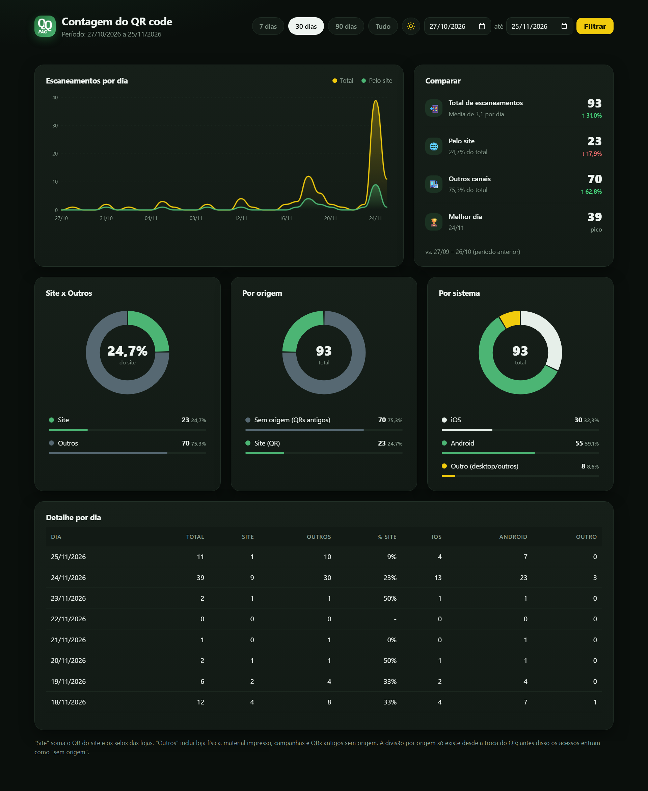
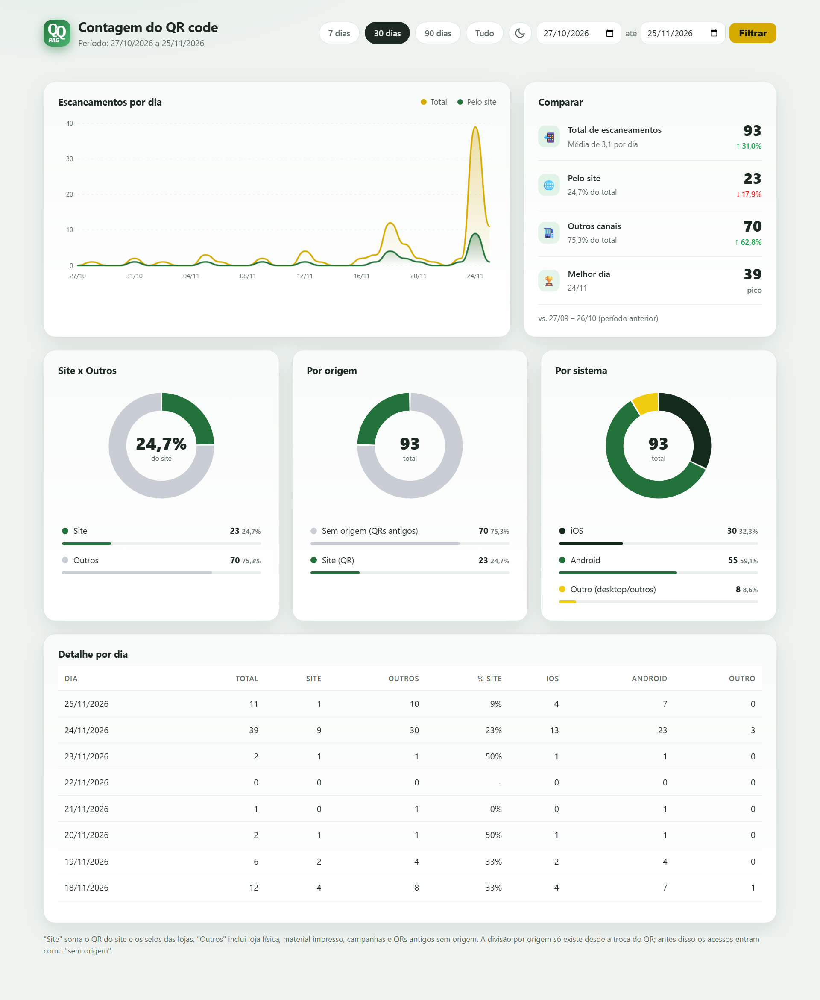

# Dashboard de Contagem de QR Codes

Dashboard desenvolvido para monitorar e analisar os escaneamentos de QR Codes, permitindo a separação dos acessos realizados pelo site e por outros canais.

O projeto apresenta os dados de forma visual e organizada, facilitando a comparação dos resultados, a identificação de picos de acesso e o acompanhamento dos escaneamentos ao longo do tempo.

## Visão geral

O dashboard permite acompanhar o volume de escaneamentos e analisar sua distribuição por origem e sistema utilizado.

### Funcionalidades

- **Filtros por período:** consulta dos dados dos últimos 7, 30 ou 90 dias, além de períodos personalizados.
- **Separação por canal:** diferencia os escaneamentos realizados pelo site daqueles provenientes de outros canais, como lojas físicas, materiais impressos e campanhas.
- **Comparação de resultados:** apresenta o total de escaneamentos, a média diária, as variações em relação ao período anterior e o dia de maior movimento.
- **Análise por origem:** identifica a distribuição dos acessos entre QR Codes do site e QR Codes de outras origens.
- **Análise por sistema:** apresenta os escaneamentos realizados em dispositivos iOS, Android e outros sistemas.
- **Detalhamento diário:** tabela com os dados de cada dia, incluindo totais, origem dos acessos e distribuição por sistema.

## Interface

O dashboard possui dois temas visuais, permitindo visualizar os dados em diferentes estilos de apresentação.

### Tema escuro

### Tema claro

## Objetivo do projeto

Desenvolver uma ferramenta de visualização de dados que facilite o acompanhamento dos escaneamentos de QR Codes, possibilitando a análise dos canais de acesso e o entendimento do comportamento dos usuários.

A separação entre os QR Codes do site e os demais canais permite identificar a participação de cada origem nos resultados e acompanhar seu desempenho ao longo do tempo.
